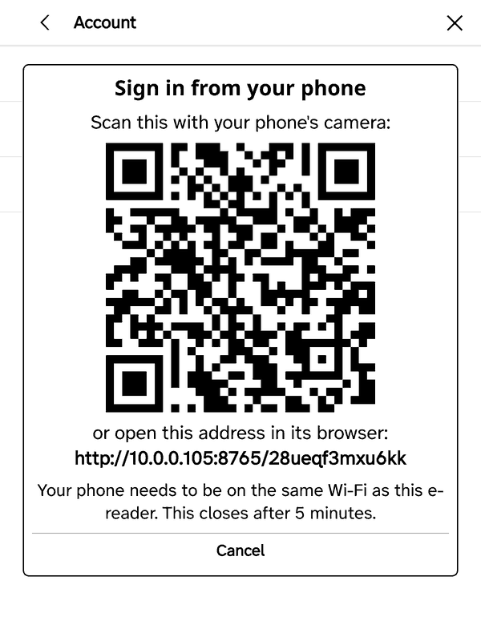
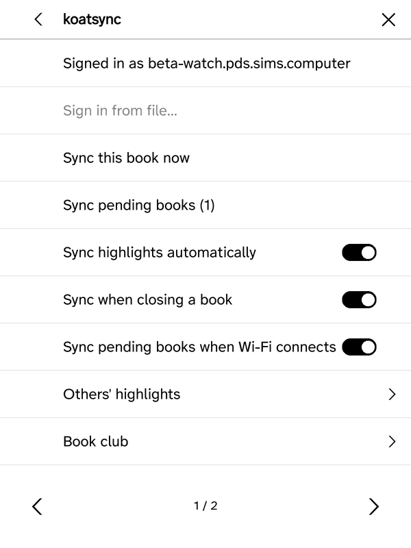
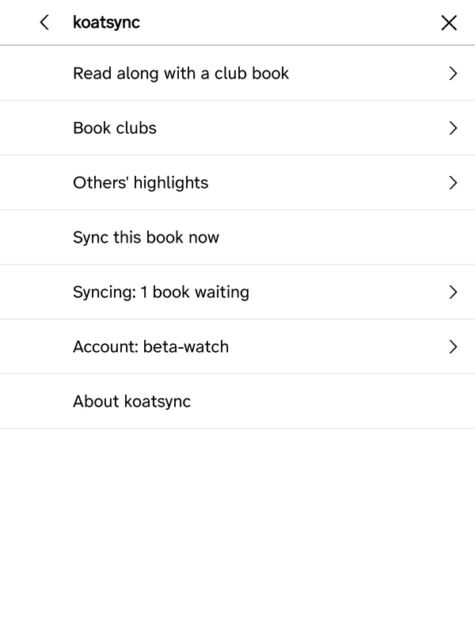
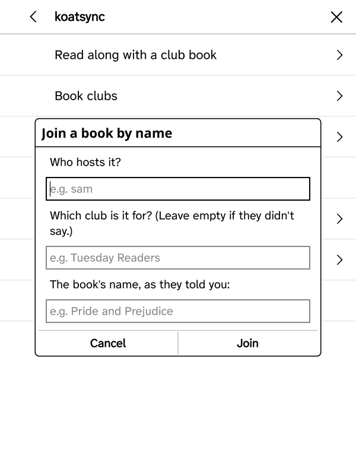
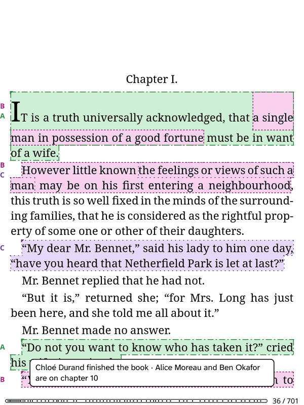

# Changelog

What changed in each koatsync release, newest first. Downloads are on the
[releases page](https://github.com/simsinght/koatsync/releases); with ZenPM, updates arrive on their
own (see [Install with ZenPM](README.md#install-with-zenpm)).

## v0.3.5 - 2026-11-12

**Sign in from your phone.** **Tools → koatsync → Account → Sign in from your phone…** shows a QR
code. Scan it, type your handle and password on the phone, and the e-reader signs in. No more
passwords on an e-ink keyboard. The e-reader serves that page itself, only while the code is on
screen, five minutes at most.

**A shorter menu.** koatsync's menu fits on one page: the open book's read-along first, then Book
clubs, Others' highlights, Sync this book now, Syncing, Account and About. The sync switches moved
into Syncing, signing in and out into Account.

| Before | After |
| --- | --- |
|  |  |

**Book clubs.**
- The same book can now be hosted in two different clubs. Hosting a book again in the same club
  offers to use the one that is already there instead of starting a second.
- Joining a book as a guest asks three things: who hosts it, which club it is for, and the book's
  name. For a book hosted before this version, leave the club empty.

**Typed sign-in.** It is now called **Sign in with handle and password…**, and its field says
Password, with the same note as the phone page about app passwords.

Known limits:
- The phone and the e-reader have to be on the same Wi-Fi. Some guest networks keep devices from
  seeing each other; sign in on the e-reader there.
- The phone page is plain HTTP on your Wi-Fi. Opened from the QR code, the form is sealed in the
  phone's browser before it is sent, which keeps the password from someone listening in, but not
  from someone able to tamper with the network.
- An app password syncs and shares, but can't show other members' highlights yet. Use your account
  password for that.

## v0.3.4 - 2026-11-12

**Where the others are.** In a read-along book, koatsync now shares how far you have got: chapter
number, percentage, or finished. Opening the book shows one line, such as "Chloé Durand finished the
book · Alice Moreau and Ben Okafor are on chapter 10". The same is on each person's card and under
**Others' highlights → Where the others are**. Chapter titles are never shared, people you hid are
left out, and the read-along question tells you it is shared.

**Quieter.** Syncing when you close a book or when Wi-Fi connects no longer shows a banner when it
works; failures follow the rule from v0.3.3.

**Fixed.** Joining a club you own now loads its books.

Known limit: where you are is only sent along with a sync that happens anyway (after a highlight,
on closing the book, when Wi-Fi connects), and only after a new chapter, finishing, or 5% more. The
others may see you a little behind.

## v0.3.3 - 2026-11-12

**Quiet automatic sync.** The sync after each highlight no longer shows a banner when it works. A
failure shows once when it is a new kind of failure, and the same kind at most once a day; a sync
that works resets that. **Sync this book now** still tells you every result.

**Note button.** ZenOS 4.3.2 brings its own Note button to the selection toolbar; koatsync now
recognises it and doesn't add a second one.

## v0.3.2 - 2026-11-12

**Note button in ZenOS.** ZenOS's selection toolbar has no Add note, so a note took highlight, tap,
note icon. koatsync adds a Note button after Highlight that saves the highlight and opens the note
editor in one step.

**Nothing goes out early.** In a club book, automatic sync waits while the note editor is open, so a
highlight can't be shared before you have chosen Save or Save private.

## v0.3.1 - 2026-11-11

**Club screens.** Joining, creating and hosting show what they are doing and end in a plain result
or error. Hosting lists the club with everyone ticked. Anything destructive asks first.

**Hide a person.** Tap a name in a highlight popup to see their card, and hide them in this book.
Bring them back from **Others' highlights → Hidden in this book**.

**Spoiler-safe.** Passages from elsewhere in the book are no longer listed, only counted.

**Readable straight away.** Others' highlights load in the background with a small progress bar you
can tap away, so a first open doesn't hold up the book.

**Notes cue.** An optional status-bar mark on pages where others left notes (off by default).

## v0.3.0 - 2026-11-11

**Book clubs.** Create a club and add members, or join one with its owner's name and the club's name.
Whoever hosts a book does it in a space of its own, so who reads which book can differ, and guests
from outside the club can be added.

**Read along.** Opening a book on your club's list (same ISBN, or same title and author, so other
editions count) asks whether to read along. If you do, your highlights for that book go to the
book's shared space instead of your public repo.

**Others' highlights from the club.** Other readers' highlights now come from the book's space,
are checked before they are shown, and are kept on the device for reading offline.

**Leaving.** Leaving a read-along deletes your shared highlights from it; your own stay. Highlights
mirrored publicly before can be moved into the club.

Known limit: everyone in the club needs an account on a PDS that runs the atproto spaces alpha.

## v0.2.0 - 2026-11-11

The first release.

**Your highlights on your own PDS.** Every highlight and note in KOReader is mirrored to your AT
Protocol PDS, with a record for the book. Edits and deletions follow. Syncs run after you highlight,
when you close a book and when Wi-Fi connects, and never turn Wi-Fi on by themselves. **Export
highlights** can send many books at once.

**Install with ZenPM.** Each release carries the plugin zip and a ZenPM source manifest, so ZenPM
can install and update koatsync.

**Others' highlights (prototype).** Other readers' highlights can be drawn over the page, found in
your edition by their text even when it is a different file. In this release they come only from a
local test file.

**Save private** (behind a dev switch): in a club book's note editor, a private note never leaves
the device.

Known limit: needs KOReader 2025.04 or newer.
