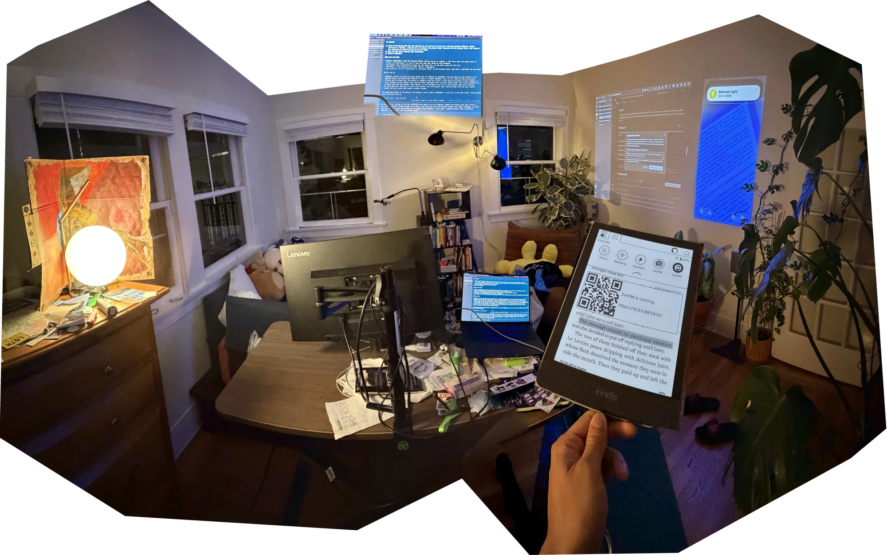

<p align="center">
  <a href="https://sims.computer/screenshotForKoAtKlub.png">
    
  </a>
</p>

<h1 align="center">koatsync</h1>

<p align="center">
  <em>a book club in the margins.</em><br>
  your <a href="https://koreader.rocks/">KOReader</a> highlights, kept on your own
  <a href="https://atproto.com/">AT Protocol</a> PDS, and shared with the people you read with.
</p>

---

I whipped this up on vacation because my highlights were stuck on a Kindle. Then it turned into a
book club thing: a few of us read the same book on e-readers, and I wanted to see what everyone
else underlined, right there on the page, without all of us moving into somebody's app.

So koatsync does two things:

- **Keeps your highlights somewhere that's yours.** Every highlight and note is mirrored to your
  PDS as `at.stim.reading.book` and `at.stim.reading.highlight` records.
- **Puts your friends in the margins.** Other readers' highlights show up over the page, even when
  their copy of the book isn't the same file as yours. Tap one to see who it was and what they said.

### The rules it plays by

- **Your notes stay your notes.** KOReader's own sidecar files remain the source of truth.
  Everything here is a layer on top; uninstall it and your books are exactly as they were.
- **No server in the middle.** The device talks to PDSes directly.
- **Private means private.** Club sharing runs on atproto permissioned spaces, and a note saved as
  private never leaves the device.
- **It doesn't touch your Wi-Fi.** Syncs happen when the radio is already on, and wait otherwise.

### Where it's at

Early, and moving fast. For now everyone in a club needs an account on a PDS that runs the
atproto spaces alpha.

| | |
| --- | --- |
| Mirroring your highlights to a PDS | works, in daily use |
| Clubs: create, add members, join by owner name + club name | works |
| Read-alongs: one permissioned space per book, offered when you open a matching book | works |
| Others' highlights on the page, re-anchored across editions, cached for offline | works |
| "Save private" in the note editor of a club book | works |
| Hide a person per book, spoiler-safe lists, friendlier club screens | works, being tried by the club |

Looks best with [ZenOS](https://github.com/xZenLabs/zen-os). Works without it.

## What it does

- Every highlight and note becomes one record on your PDS, linked to a book record with title,
  authors, ISBN when the file declares one, and the file's KOReader hash.
- Records carry the highlight's position (crengine xpointers or PDF coordinates), chapter, page,
  colour and style, so they can be restored into KOReader later.
- Syncs are diffs: each book keeps a ledger of what the PDS holds. Edits update records, deletions
  delete them, and running a sync twice sends nothing the second time.
- Nothing turns Wi-Fi on by itself. Automatic syncs only run when the radio is already up; otherwise
  the book is flagged and sent later.

## Install

Copy `koatsync.koplugin` into KOReader's `plugins` directory and restart KOReader.

| Device | Plugins directory |
| --- | --- |
| Kobo | `.adds/koreader/plugins/` |
| Kindle | `koreader/plugins/` |
| PocketBook | `applications/koreader/plugins/` |
| Android | `koreader/plugins/` under internal storage |
| Desktop | `koreader/plugins/` next to the program |

Needs KOReader 2025.04 or newer (for the Export Highlights integration).

### Install with ZenPM

Every tagged release carries `koatsync.koplugin.zip` and a one-package
[ZenPM](https://github.com/xZenLabs/zen-pm) `manifest.json`. In ZenPM open **Sources** and add

```
https://github.com/simsinght/koatsync/releases/latest/download
```

(or `zenpm repo add koatsync https://github.com/simsinght/koatsync/releases/latest/download`), then
install **koatsync**. ZenPM offers an update whenever a newer release is tagged. An update replaces
the whole `koatsync.koplugin` folder; your sign-in, settings and caches live in KOReader's settings
and data folders and are kept.

koatsync is not in ZenPM's built-in ZenLabs Repo yet, so it won't show up there without the source.

## Sign in

**Tools → koatsync → Sign in to your PDS…** asks for your handle, an app password, and optionally
your PDS URL. Leave the URL blank if your handle resolves publicly; fill it in for a self-hosted PDS
whose handles have no DNS of their own.

To skip typing on the device, choose **Tools → koatsync → Sign in from your phone…**. The e-reader
shows a QR code and an address; open it on a phone on the same Wi-Fi and fill in the form there. The
e-reader serves that page itself, only while the QR code is showing (five minutes at most), and only to
the one-time address in the code. The page is plain HTTP on your Wi-Fi; when opened from the QR code
the form is sealed in the phone's browser with a key that never crosses the network, which keeps the
password from anyone merely listening in, but not from someone able to tamper with your network's
traffic.

Or put a `koatsync_login.txt` in the KOReader folder over USB:

```
handle=you.example.com
password=your-app-password
pds=https://pds.example.com   # optional
```

then choose **Tools → koatsync → Sign in from file…**. The file is deleted once the sign-in succeeds.

The app password is stored in KOReader's settings directory in plain text, the same way KOReader's own
progress sync stores its password. Use an app password, never your account password.

## Syncing

- **Automatic**: on by default. About ten seconds after you stop editing a highlight or note, the
  book is synced if Wi-Fi is on.
- **On close**: a book with unsent changes is synced when you close it, if Wi-Fi is on.
- **When Wi-Fi connects**: pending books go out shortly after the device comes online.
- **Manual**: **Sync this book now** and **Sync pending books** in the menu, also available as
  dispatcher actions (`koatsync: sync this book`, `koatsync: sync pending books`,
  `koatsync: toggle automatic sync`) for gestures.
- **Bulk backfill**: enable **koatsync (PDS)** under **Tools → Export highlights → Choose formats**,
  then export from the file browser to push many books at once.

## ZenOS

The plugin follows what [ZenOS](https://github.com/xZenLabs/zen-os) looks for:

- Its menu is a submenu, so **Add → Plugin Menu** in Controls, Navbar and Launcher can open it.
- Its dispatcher actions can be bound to Controls, Navbar and Launcher buttons, and to gestures.
- While books are waiting to sync it shows `↑n` as a ZenOS status-bar item (`koatsync pending`),
  which you can place under Zen Settings.

It deliberately adds no button to the text-selection menu: ZenOS hides unknown selection buttons by
default, and the automatic mirror makes one unnecessary.

## Others' highlights (prototype)

Highlights other readers made in the same book are drawn over the page with a dashed outline (and a
per-person tint and coloured initial on colour screens). They are never added to your own
annotations, so they are never synced as yours. Tap one for a small popup naming who made it (with
their marker); if anyone left a note, it lists each person with their note instead. Tap a person
in it for their card: their whole note, and **Hide in this book**, which hides everything of theirs
in that book at once (they are then neither fetched nor placed nor drawn). Your own highlights,
links and page-turn taps behave as before. People are shown by display name, else by a short
handle (the server part is dropped when it is your own).

- The book does not have to be the same file. When the file hash matches, the stored xpointers are
  used; otherwise the passage is searched for in your edition, tolerating punctuation and small
  wording differences. Results are cached per file, so each highlight is searched for once.
- Fetching and placing run in the background, a few at a time, nearest your reading position first,
  so the book stays readable while a first open works through a few dozen highlights. A small bar
  at the bottom shows progress when there is a lot to do; any tap dismisses it and the work carries
  on. Closing the book midway loses nothing: the next open continues.
- **Tools → koatsync → Others' highlights** has the show/hide toggle, a count (on their pages / not in
  this edition / hidden; tap it for a short explanation), **Hidden in this book** to show people
  again, a refresh, and an optional status-bar cue (`✎ 2` on pages where two people left notes; off
  by default). The toggle is also a dispatcher action, `koatsync: show/hide others' highlights`.
- Spoilers: nothing lists other people's passages or notes. The popup only shows what is under your
  finger on the page you are reading; everything else is counts.
- In a book that reads along with a club (below) they come from the book's space, cached on the
  device so the overlay works offline with the last fetched state. They are refreshed when the book
  opens with Wi-Fi already on, after each sync, and from **Others' highlights → Refresh from the club**.
- Any other book falls back to a dev fixture: a JSON file in `<KOReader folder>/koatsync/others/`,
  named `<partial md5>.json` or after the title (`pride-and-prejudice.json`): a list of
  `{author: {did, handle, displayName}, uri, cid, bookFileHash, record}`.

## Book clubs

A club is an atproto permissioned space; each book the club reads gets a space of its own, so who
reads which book can differ. Everything is under **Tools → koatsync → Book club** (in ZenOS, add
koatsync to the Launcher with **Add → Plugin Menu**). Every step that needs the network asks for
Wi-Fi if it is off, shows what it is doing, and ends in a plain-language result or error.

For a member:

- **Join a club…** asks who runs it and the club's name (on a shared server the first part of a name
  is enough: `sam` becomes `sam.<your server>`). It works once the owner has added you; until then
  the message says so and offers **Try again**.
- When you open a book on the club's list (same ISBN, or the same title and author surname, so other
  editions count), koatsync asks "Read along with <club>?", saying where your highlights will go and
  that the ones you already made are shared too. **Not now** asks again next time you open the book;
  **Not this book** stops asking for that file. **Read along with a club book** does the same by hand
  (it also has **Join a book by its host's name…** for a guest).
- **Reading along: <club>** shows where the book stands. **This book → Leave this read-along…**
  deletes your shared highlights from the club; your own highlights and notes stay, and the book is
  not offered again automatically.
- **<club> → Remove this club from this device…** forgets it locally; nothing is deleted.

For whoever runs the club or hosts a book:

- **Create a club…** (one field), then **Add members** (names separated by commas). Members are
  listed under the club, where tapping one offers to remove them.
- **<club> → Host this book for the club…** shows everyone in the club ticked; untick who should not
  read it, optionally rename the book or add guests from outside the club, then **Host**.
- **This book** (host) has **Add readers…** (club members not yet in, or anyone by name), **Remove
  readers…**, and **Delete this book's read-along for everyone…**; **<club> → Delete this club for
  everyone…** removes the club. Each destructive step says exactly what goes and what stays.
- In a linked book your shared highlights and notes go to your own repo inside the book's space, not
  your public repo. "Save private" ones never leave the device. If the book was mirrored publicly
  before, **This book → Move public highlights into the club…** deletes the public copies once the
  club has them; until then the public copy gets edits and deletions but nothing new.

Others' highlights are read with a space credential and shown only once verified with a record MAC
(`clubsource.lua` explains the scheme and its cost).

## Data model

Lexicons are in `lexicons/`. In short:

- `at.stim.reading.book`: title, authors, identifiers (isbn13/isbn10/asin/openLibrary/fileHash/
  fileName), language, format, pages, optional status and progress, timestamps.
- `at.stim.reading.highlight`: book (at-uri), text, note, chapter, color, style, locator
  (`koreader-xpointer` or `koreader-pdf` start/end plus page and page label), optional prefix/suffix
  context, tags, generator, timestamps.

Position locators only make sense against the same file bytes, which is why the book record carries
KOReader's partial MD5 of the file.

Clubs (see `club.lua` for the full picture):

- Space types: `at.stim.reading.club` for a club (key: slug of the club name, owned by its creator,
  publishes its member list to members) and `at.stim.reading.readAlong` for one book a club reads
  (key: slug of the book's name, owned by its host).
- `at.stim.reading.clubProfile` (rkey `self`, owner's repo in the club space): the club's name.
- `at.stim.reading.clubBook`: title, authors, identifiers, the book space's URI and the club's. The
  host writes it into the club space (rkey = the book space's key) and into the book space (rkey `self`).
- Inside a book space every reader writes the same `at.stim.reading.book` and
  `at.stim.reading.highlight` records as in a public repo, into their own repo there.
- On the device: clubs (with their last member list), known books, links (keyed by the file's
  partial MD5), declined offers and display names in `settings/koatsync.lua`; per book, people hidden
  in it under `hidden_people` in the sidecar's `koatsync` table, the public ledger stays at the top of the
  sidecar's `koatsync` table and each book space gets its own ledger under `spaces[<space uri>]`;
  others' records per book space in `cache/koatsync/space-*.lua`.

## Development

Off-device tests run on LuaJIT with the same libraries KOReader bundles:

```sh
brew install luajit luarocks
LJ=$(brew --prefix luajit)
luarocks --lua-version 5.1 --lua-dir "$LJ" --tree ./.luarocks install luasocket
luarocks --lua-version 5.1 --lua-dir "$LJ" --tree ./.luarocks install luasec OPENSSL_DIR=$(brew --prefix openssl@3)
luarocks --lua-version 5.1 --lua-dir "$LJ" --tree ./.luarocks install rapidjson
koatsync.koplugin/spec/run.sh              # unit + stubbed plugin scenarios
koatsync.koplugin/spec/run.sh integration  # live round trip against the PDS in .env
koatsync.koplugin/spec/run.sh spaces       # live permissioned-spaces round trip (two accounts)
koatsync.koplugin/spec/run.sh club         # live book-club story (three accounts)
KOREADER=/Applications/KOReader.app/Contents/koreader koatsync.koplugin/spec/run.sh [spaces|club]
                                           # crypto spec (or a live run) on KOReader's own luajit and libcrypto
```

The integration run needs a `.env` with `ATP_PDS`, `ATP_HANDLE`, `ATP_DID` and `ATP_PASSWORD`.
It creates and deletes its own records.
The spaces run also needs `ATP_MEMBER_HANDLE`, `ATP_MEMBER_DID` and `ATP_MEMBER_PASSWORD` for a second account;
it keeps the `at.stim.reading.club` / `koatsync-spec` space between runs and deletes its records.
With `ATP_OUTSIDER_HANDLE` and `ATP_OUTSIDER_PASSWORD` naming a third account (never added to the space)
it also checks that a non-member is refused.
The club run needs all three accounts. It creates the `koatsync spec club` club and the
`koatsync-spec-pride-and-prejudice` book space under the first account, plays the whole story
(join, host, discover, link, highlights both ways with verification, private notes, public-to-club
move, guest, leave, removal, outsiders refused), deletes every record and then both spaces. It
never writes to the first account's public repo.
`spacecrypto.lua` loads libcrypto through FFI; set `KOATSYNC_LIBCRYPTO` to a path to override the search.

`dev/koreader.sh <profile> [book]` runs the macOS KOReader build on a throwaway profile; with
`KOATSYNC_DEV=1` it also links `dev/patches/` (HTTP-inspector helpers to run a Lua file and inject
taps), which `dev/make_fixture.lua` uses to build an others'-highlights fixture from the open book.

Module map:

- `atproto.lua`: XRPC client (session, renewal, identity resolution, records, applyWrites).
- `spacecrypto.lua`: P-256 keys/did:key, ECDH, HMAC/HKDF and the space-credential HTTP signatures and
  record MACs, over libcrypto (LuaJIT FFI).
- `drisl.lua`: DRISL (deterministic CBOR) encoding and CIDs, to check a record against its CID.
- `spaces.lua`: permissioned spaces (space policy and members, own-repo writes, credentialed and
  MAC-verified cross-member reads, writer listing).
- `records.lua`: pure mapping between KOReader annotations and records, both directions.
- `sync.lua`: diff a book's annotations against its ledger and push in batches.
- `store.lua`: plugin settings and per-book sidecar state.
- `exporter.lua`: target for KOReader's Export Highlights.
- `anchor.lua`: finds a quoted passage in a (possibly different) edition; pure, with a crengine adapter.
- `others.lua`: places other readers' highlights for a book, with a per-file cache.
- `club.lua`: clubs, the pure part (slugs, book matching, record builders, rosters, listing diffs).
- `clubs.lua`: clubs over spaces (create/join, members, host/join books, links to local files).
- `clubsource.lua`: others' highlights from a book space, verified and cached on disk.
- `clubmenu.lua`: the Book club menu and its screens (join, host, members, readers, leave, delete).
- `fixturesource.lua`: others' highlights from a JSON file per book (dev fallback).
- `overlay.lua`: draws others' highlights as a reader view module.
- `othersreader.lua`: others' highlights in the reader (background fetching and placing, hiding people,
  taps, menu, the optional status-bar cue).
- `othersprogress.lua`: the dismissable progress bar for that background work.
- `otherspopup.lua`, `popuplayout.lua`: the tap popup, and its pure row/placement logic.
- `main.lua`: menus, dispatcher actions, events, ZenOS hooks.
